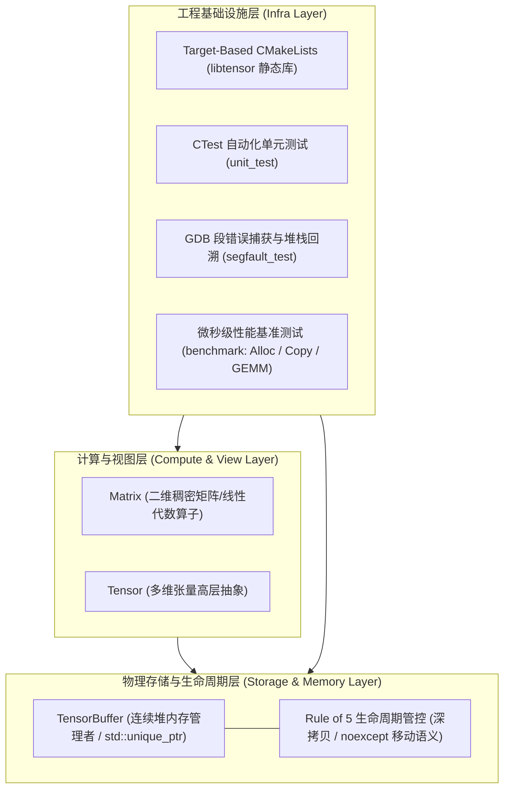

# TinyTensor v0.1

[](https://en.cppreference.com/w/cpp/17)
[](https://cmake.org/)
[](LICENSE)

**TinyTensor** 是一个面向边缘计算（Edge AI）推理场景的轻量级现代 C++ (C++17) 算子与张量基础设施实验库。

本项目从零手搓核心组件，旨在打通底层物理内存生命周期管理、现代 CMake Target 构建范式、GDB 底层调试与硬件级性能基准评测，完成从零构建 AI 运行时引擎的完整闭环。

---

## 目录

- [一、 系统整体架构 (Architecture)](#一-系统整体架构-architecture)
- [二、 核心 API 规范 (API Reference)](#二-核心-api-规范-api-reference)
- [三、 构建、测试与调试指南 (Build, Test & Debug)](#三-构建测试与调试指南-build-test--debug)
- [四、 性能基准评测报告 (Benchmark Results)](#四-性能基准评测报告-benchmark-results)
- [五、 核心踩坑与底层心法复盘 (Pitfalls & Key Learnings)](#五-核心踩坑与底层心法复盘-pitfalls--key-learnings)
- [六、 演进路线规划 (Roadmap to v0.2)](#六-演进路线规划-roadmap-to-v02)

---

## 一、 系统整体架构 (Architecture)

TinyTensor 遵循工业级深度学习框架（如 PyTorch `c10::Storage` 与 `c10::TensorImpl`）的**职责分离架构（Separation of Concerns）**，将高层数学计算与底层物理内存存储彻底解耦：



### 模块结构
```text
edge-ai-cpp-lab/
├── CMakeLists.txt          # Target-Based 模块化构建配置
├── include/
│   ├── Matrix.h            # 二维矩阵与数学运算接口
│   └── Tensor.h            # Tensor 与 TensorBuffer 内存管理接口
├── src/
│   ├── Matrix.cpp          # 基础矩阵乘法与四则运算符实现
│   ├── Tensor.cpp          # TensorBuffer Rule of 5 与生命周期实现
│   └── main.cpp            # 算子应用与调试主入口 (example)
├── tests/
│   ├── TensorBufferTest.cpp# 单元测试与 100MB 移动语义专项测试 (unit_test)
│   └── segfault_test.cpp   # GDB 段错误（空指针解引用）定位实验
└── benchmark/
    └── benchmark.cpp       # 内存分配/带宽拷贝/GEMM 算力基准测试
```

---

## 二、 核心 API 规范 (API Reference)

### 1. `TensorBuffer`（底层物理内存管理者）
专职负责连续浮点堆内存的生命周期管理，基于 `std::unique_ptr<float[]>` 保证绝对的异常安全与 RAII。

- **显式五法则 (Rule of 5)**：
  - `TensorBuffer(const TensorBuffer& other);`  
    **深拷贝构造**：独立分配物理堆内存并执行总线逐字节拷贝。
  - `TensorBuffer& operator=(const TensorBuffer& other);`  
    **深拷贝赋值**：采用强异常安全机制（先开辟新内存再转移状态），具备自赋值防护。
  - `TensorBuffer(TensorBuffer&& other) noexcept;`  
    **移动构造**：偷取源对象的 `unique_ptr` 裸指针，并将原对象重置为空状态，标记 `noexcept` 防止容器退化。
  - `TensorBuffer& operator=(TensorBuffer&& other) noexcept;`  
    **移动赋值**：转移所有权并清空原宿主。
  - `~TensorBuffer();`  
    **析构函数**：自动触发底层智能指针销毁，释放连续内存块。
- **数据访问与操作**：
  - `float& at(size_t index);`：带边界防御的元素安全访问，越界抛出 `std::out_of_range`。
  - `float* data() noexcept;`：高性能裸指针接口，供后续直接接入 SIMD 指令或 BLAS 库。
  - `void reshape(const std::vector<int>& new_shape);`：在总元素数守恒前提下重塑张量维度。
  - `void fill(float value) noexcept;`：连续内存极速批量填充。

### 2. `Matrix`（二维线性代数载体）
- **运算符重载**：
  - 复合赋值：`+=`, `-=`, `*= (标量及矩阵乘法)`, `/=`
  - 矩阵四则算术：`operator+`, `operator-`, `operator*(Matrix, Matrix)`
  - 标量双向乘除：`operator*(Matrix, float)`, `operator*(float, Matrix)`, `operator/(Matrix, float)`
- **下标访问**：`operator()(int r, int c)`，带边界安全检查。

---

## 三、 构建、测试与调试指南 (Build, Test & Debug)

### 1. 编译构建（Target-Based CMake）
本项目使用现代 CMake 3.20+，生成 `libtensor` 静态库并驱动三大可执行目标：

```bash
# 1. 生成构建目录
cmake -B build

# 2. 编译所有目标 (Debug 模式)
cmake --build build --config Debug
```

### 2. 自动化单元测试 (CTest)
```bash
# 运行全部注册测试用例
ctest --test-dir build --output-on-failure
```

### 3. GDB 调试段错误实战
针对移动后原宿主空指针解引用引起的崩溃，采用 GDB 在微秒级定位案发现场：

```bash
# 1. 使用 g++ 注入 DWARF 符号编译
g++ -std=c++17 -g -Iinclude src/Tensor.cpp tests/segfault_test.cpp -o segfault_gcc.exe

# 2. 进入 GDB 调试
gdb ./segfault_gcc.exe

# 3. 抓捕案发现场三板斧
(gdb) run               # 触发崩溃：Program received signal SIGSEGV, Segmentation fault.
(gdb) bt                # 打印调用栈：精确到 segfault_test.cpp:12
(gdb) print ptr         # 检查作案工具：$1 = (float *) 0x0 (确认解引用了 nullptr)
(gdb) quit
```

---

## 四、 性能基准评测报告 (Benchmark Results)

基准测试运行环境：Windows x86_64, MSVC / UCRT64 GCC, C++17。

### 1. 实测数据汇总

| 测试大类 | 测试项 | 规模 / 形状 | 耗时 (Latency) | 性能指标 (Throughput / GFLOPS) |
| :--- | :--- | :--- | :--- | :--- |
| **内存申请** | Small Tensor Alloc | `[1, 256]` (1 KB) | **1 $\mu\text{s}$** | 纳秒级分配 |
| **内存申请** | Mid Tensor Alloc | `[1, 262144]` (1 MB) | **291 $\mu\text{s}$** | 包含虚拟内存首次映射 |
| **内存申请** | Big Tensor Alloc | `[100, 262144]` (100 MB) | **34.39 ms** | 操作系统大页调度与置零 |
| **深拷贝** | Small Tensor Copy | `10 MB` | **3.23 ms** | 3.10 GB/s 内存带宽 |
| **深拷贝** | Mid Tensor Copy | `50 MB` | **15.98 ms** | 3.13 GB/s 内存带宽 |
| **深拷贝** | Big Tensor Copy | `100 MB` | **30.25 ms** | **~3.31 GB/s** (达到单线程带宽瓶颈) |
| **移动语义** | 100MB Move 构造 | `100 MB` | **6 $\mu\text{s}$** | **加速比 > 5,000x** (指针零拷贝) |
| **GEMM 算力** | Naive Matmul | $64 \times 64$ | **1.54 ms** | **0.340 GFLOPS** |
| **GEMM 算力** | Naive Matmul | $128 \times 128$ | **12.82 ms** | **0.327 GFLOPS** |
| **GEMM 算力** | Naive Matmul | $256 \times 256$ | **98.58 ms** | **0.340 GFLOPS** (算力基线锁定) |

### 2. 硬件行为与数据深度分析
1. **内存带宽瓶颈（Memory Bandwidth Bound）**：  
   从 10MB、50MB 到 100MB，深拷贝吞吐量极其稳定地收敛于 **~3.31 GB/s**。这反映了现代 CPU 在单线程、纯标量循环下的真实内存总线吞吐上限。
2. **移动语义的毁灭级优势**：  
   拷贝 100MB 耗时 30,249 微秒，而移动 100MB 仅耗时 **6 微秒**，实现了超过 **5,000 倍的性能跨越**。证明了在推理管线中保持移动语义对消除计算卡顿的极端重要性。
3. **GEMM 算力基线（Performance Baseline）**：  
   朴素三重循环下的方阵乘法算力高度恒定在 **0.34 GFLOPS**（单核每秒 3.4 亿次乘加）。该数据将作为后续引入 SIMD 向量化与多线程并行的首要对比基准。

---

## 五、 核心踩坑与底层心法复盘 (Pitfalls & Key Learnings)

在工程落地过程中，沉淀出以下 5 个极具价值的 C++ 底层心法：

### 1. 移动语义的“掏空”机制与 Double Free 防御
- **现象**：移动后的 `TensorBuffer` 原宿主对象调用 `.data()` 返回了 `nullptr`。
- **底层心法**：`std::unique_ptr` 在执行移动时，会在接管裸指针的同时**将原指针置为 `nullptr`**。根据 C++ 标准，`delete[] nullptr` 是合法的空操作（No-op）。这使得原宿主在离开作用域析构时不会重复释放堆内存，彻底杜绝了恶名昭彰的 **Double Free**。

### 2. 跨平台符号之争：MSVC PDB vs GDB DWARF
- **现象**：使用 GDB 调试 MSVC 生成的程序时，崩溃调用栈显示为全问号 `?? ()` 且提示 `No debugging symbols found`。
- **底层心法**：MSVC 默认将符号表剥离在独立的 `.pdb` 文件中，而 GDB 仅识别内嵌于二进制中的 Linux/GNU 标准 `DWARF` 格式。使用 `g++ -g` 编译方可为 GDB 提供行号和变量映射支持。

### 3. CMake 顺序执行机制与 Windows 中文编码 (C4819)
- **现象**：在 `CMakeLists.txt` 结尾配置了 `/utf-8`，但编译包含中文注释的源码时依然触发 MSVC C4819 告警。
- **底层心法**：CMake 的 `add_compile_options()` **仅对其下方声明的 Target 生效**！将编译选项移至文件顶部、所有 `add_library` 与 `add_executable` 之前，才能确保整个项目全局继承 UTF-8 编码设置。

### 4. 性能评测的“死敌”：热循环日志干扰
- **现象**：初版张量分配 Benchmark 测出小张量耗时异常膨胀。
- **底层心法**：控制台输出 `std::cout` 涉及昂贵的操作系统 I/O 调度和字符编码转换，其延迟（毫秒级）比内存微小申请（纳秒级）慢数千倍。在性能基准循环中，**严禁引入终端 I/O**。

### 5. 局部变量析构遵循严格的“先进后出 (LIFO)”
- **现象**：被 `std::move` 掏空的对象总是在测试函数末尾最后一个析构。
- **底层心法**：栈内存上的局部变量析构顺序与声明顺序**完全相反**。这不仅符合栈的物理弹出特性，更是为了保障后创建的对象能够安全引用先创建的对象而制定的 C++ 语言铁律。

---

## 六、 演进路线规划 (Roadmap to v0.2)

- [ ] **高维步长系统 (Strides & Strided Layout)**：实现多维物理索引变换。
- [ ] **零拷贝切片与转置 (View & Permute)**：支持元数据变换下的零开销运算。
- [ ] **广播机制 (Broadcasting)**：支持自动对齐不同维度的逐元素算子。
- [ ] **硬件加速优化 (HW Acceleration)**：
  - [ ] AVX2 / ARM NEON 向量指令集重写 GEMM 内核。
  - [ ] OpenMP 多核多线程并行化。
  - [ ] Cache 分块算法（Tiling）提升 CPU L1/L2 缓存命中率。
